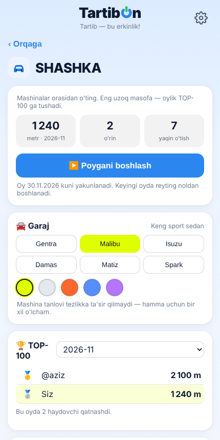
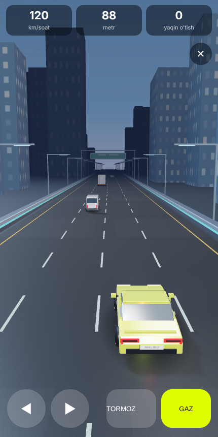
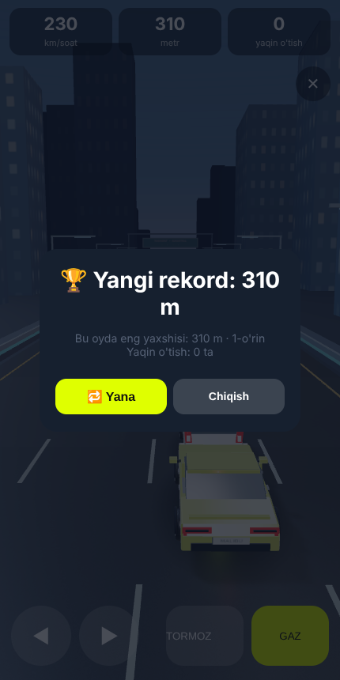

# SHASHKA — 3D trafik poygasi TartibOn ichida

Yuborgan manba kodingiz (`shashka-traffic-source`) ilovangizga qo'shildi.
`index.php` — tayyor, yangilangan fayl. Yuklang va ishlaydi; boshqa hech narsa
o'rnatish kerak emas.

| | |
|---|---|
| Fayl hajmi | 2 044 511 → 2 171 232 bayt (**+127 KB**) |
| Yangi jadvallar | `sh_run`, `sh_rec` — birinchi ochilishda o'zi yaratiladi (`mig_sh1`) |
| Yangi API | `sh_get`, `sh_start`, `sh_fin`, `sh_post` |
| Yangi bo'lim | Bosh sahifada «SHASHKA» kataki, `?startapp=s_sh` havolasi |
| Tashqi bog'liqlik | three.js CDN'dan (~160 KB siqilgan, brauzer keshlaydi) |



---

## Nima o'zgardi, nima qoldi

**Qoldi — o'yinning o'zi.** `RaceScene.ts`, `vehicles.ts`, `simulation.ts`
bitta satr ham o'zgartirilmagan. Faqat TypeScript turlari olib tashlandi
(Node'ning o'z `stripTypeScriptTypes` vositasi bilan — qo'lda tahrir yo'q),
so'ng uchalasi bitta ES modulga birlashtirildi. Damas, Isuzu, Gentra, Malibu,
Matiz, Spark modellari, kechki shahar, ovoz — hammasi o'zingiznikidek.

**O'zgardi — interfeys.** `App.tsx` (React + lucide-react) TartibOn uslubidagi
oddiy JS bilan qayta yozildi: ilovada React yo'q va build bosqichi ham yo'q.

**O'zgardi — server.** Cloudflare Worker + D1 o'rniga sizning PHP + MySQL
stekingiz. `worker/api.ts` mantiqi `sh_*` API'lariga ko'chirildi,
`drizzle/0000_racing.sql` esa `sh_run` / `sh_rec` jadvallariga.

**Olib tashlandi — ikkilangan autentifikatsiya.** Asl kod har so'rovda
`initData` imzosini qaytadan tekshirardi. TartibOn buni allaqachon o'zi
qiladi (`auth_user()`), shuning uchun poyga API'lari ham shu seansdan
foydalanadi. Bot tokeni hech qayerga qo'shilmadi.

---

## Anti-chit: natija mijozdan olinmaydi

Mijoz masofani **aytmaydi** — u faqat urug' (seed) va bosishlar ketma-ketligini
yuboradi, server esa poygani PHP'da boshidan qayta o'ynab, masofani **o'zi
hisoblaydi**.

`simulation.ts` PHP'ga aynan ko'chirildi (`sh_replay`). Tekshirdim:
**304 ta tasodifiy poyga, 304 tasida ham natija bir xil** — nafaqat masofa va
yaqin o'tishlar soni, balki `distance`, `x`, `speed` ning 64-bitli double
ko'rinishi ham bayt-ma-bayt mos keldi.

> Bir xato shu yerda chiqdi va tuzatildi: PHP'da `floor()` butun son emas,
> **float** qaytaradi, shuning uchun `$car['lane'] === $occ` taqqoslash hech
> qachon rost bo'lmas ekan — trafikning chetga chiqish qoidasi serverda
> ishlamay, 7 ta poygada natija farq qilgan edi.

Soxta so'rovlar sinovi (`sinov/cheat.php`):

```
haqiqiy poyga                 -> qabul, 177 m
ticks oshirildi (+600)        -> RAD ETILDI
ticks kamaytirildi (-50)      -> RAD ETILDI
tartib buzildi                -> RAD ETILDI
begona maydon (turbo)         -> RAD ETILDI
direction=3                   -> RAD ETILDI
urug' almashtirildi           -> RAD ETILDI
bo'sh boshqaruv, uzoq poyga   -> RAD ETILDI
faqat gaz, 100000 tick        -> RAD ETILDI
```

Bundan tashqari: bitta poyga faqat bir marta hisoblanadi (`holat` ustuni),
poyga haqiqiy vaqtdan tez bo'lishi mumkin emas (`ticks` va o'tgan vaqt
solishtiriladi), bir daqiqada 8 tadan ko'p poyga boshlab bo'lmaydi.

**Server yuki:** 60 soniyalik poygani qayta hisoblash **~11 ms**. Kuniga
1000 poyga bo'lsa — jami 11 soniya protsessor vaqti.

---

## Reyting

- Oylik TOP-100, oy **Toshkent vaqti** bo'yicha almashadi (`date('Y-m')`).
- Saralash: masofa → yaqin o'tishlar → erta qo'lga kiritilgani → ID.
  (asl koddagi tartibning aynan o'zi).
- Eski oylar arxivda qoladi, bo'limdagi ro'yxatdan tanlanadi.
- `sh_post` — reytingni o'z kanal/guruhingizga joylaydi, post tagida
  «🏁 Poyga qilish» tugmasi (`?startapp=s_sh`) bo'ladi. Bitta kanalga soatiga
  bir marta.



---

## three.js haqida

three.js (626 KB) `index.php` ichiga solinmadi — u bilan birga kelishi kerak
bo'lgan `three.core.js` yana 1.4 MB, ya'ni fayl ikki baravar oshardi.
Shuning uchun u **CDN'dan** yuklanadi va brauzerda keshlanadi:

```
https://cdn.jsdelivr.net/npm/three@0.181.0/build/three.module.js
```

jsdelivr ochilmasa, kod avtomat ravishda `unpkg.com` ga o'tadi.
O'yin moduli (97 KB) esa `index.php` ning o'zidan beriladi:
`?shjs=1` manzili, bir yillik kesh va ETag bilan — ya'ni ikkinchi ochilishda
umuman qayta yuklanmaydi.

Agar CDN'siz ishlashi shart bo'lsa — `three.module.js` va `three.core.js` ni
hostingingizga qo'yib, `kod/sh-game.js` boshidagi ikki manzilni almashtiring,
keyin `kod/patch.py` ni qayta ishga tushiring.

---

## Tekshirish

```bash
php -l index.php                       # sintaksis
cd sinov && node gen.mjs && php check.php   # PHP va JS hisobi mos keladimi
php cheat.php                          # soxta so'rovlar rad etiladimi
php bench.php                          # qayta hisoblash tezligi
```

Brauzerda uchidan-uchiga sinov (3D, boshqaruv, server tekshiruvi birga):

```bash
cd sinov && python3 srv.py &           # ilova sahifasini soxta API bilan beradi
node e2e.js                            # Playwright poygani o'ynab chiqadi
```

Oxirgi ishga tushirish natijasi: sahifada xato yo'q, `sh_get → sh_start →
sh_fin` zanjiri ishladi, server qaytargan masofa mijoznikiga teng chiqdi.

---

## Kodni qayta yig'ish

`index.php` ni o'zgartirsangiz, SHASHKA'ni qaytadan qo'shish:

```bash
node kod/strip.mjs <manba>/src/game/simulation.ts sim.js   # TS -> JS
node kod/bundle.mjs                                        # sh-game.js
python3 kod/patch.py eski-index.php yangi-index.php        # joylashtirish
```

`patch.py` har bir joyni **bitta marta** topilishini tekshiradi — mos kelmasa
hech narsa yozmaydi, xato beradi. Bo'laklar `kod/part_*.txt` fayllarida:
migratsiya, PHP funksiyalari, API, sahifa, uslublar, JS va bosh sahifa kataki.


